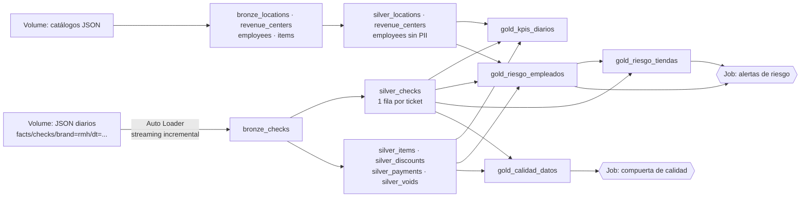

# Applebee's · Monitoreo de abuso de descuentos (Sun Holdings × Databricks Data Challenge)

**Objetivo:** construir en Databricks un pipeline reproducible que convierta los tickets diarios de RMH Applebee's en tablas confiables para **detectar patrones de abuso de descuentos por parte de empleados** y priorizar a quién y qué tienda revisar.

**Datos:** 119 archivos JSON (115 días de tickets, 28 abr – 20 ago 2026, ~2.14 M tickets, 127 tiendas activas) + catálogos de tiendas, canales, empleados e items. Los datos **no** se suben a este repositorio; viven en el volume `/Volumes/workspace/default/applebees`.

---

## Arquitectura



| Capa | Tipo de tabla | Para qué sirve |
|---|---|---|
| **Bronze** | Streaming table (Auto Loader) + vistas materializadas de catálogos | Copia fiel e incremental de la fuente, con archivo de origen y hora de ingesta (trazabilidad) |
| **Silver** | Streaming tables + vistas materializadas | Datos limpios, aplanados y conciliados; una tabla por entidad del ticket |
| **Gold** | Vistas materializadas | Tablas de negocio: KPIs, score de riesgo por empleado y tienda, calidad de datos |

## Estructura del repositorio

```
├── databricks.yml                         # Asset Bundle (despliegue del pipeline y el job)
├── resources/
│   ├── jobs/daily_orchestration_job.yml   # Job diario: pipeline → calidad → alertas
│   └── pipelines/lakeflow_pipeline.yml    # Pipeline declarativo de Lakeflow (serverless, triggered)
├── src/
│   ├── transformations/
│   │   ├── bronze/   bronze_checks.py, bronze_dimensions.py
│   │   ├── silver/   st_checks_cleaned.py, st_details_cleaned.py, mv_dimensions.py
│   │   └── gold/     mv_kpis_diarios.sql, mv_riesgo_empleados.py, mv_riesgo_tiendas.sql, mv_calidad_datos.sql
│   └── jobs/         dq_gate.py, alertas_riesgo.py
└── exploration/      Notebooks del EDA (Fase 1) donde se validaron los supuestos
```

## Tablas finales y su valor

| Tabla | Grano | Valor para el negocio |
|---|---|---|
| `silver_checks` | Ticket | Descuento total (item + ticket), propina positiva, tipo de pago real (por `PayCatName`), minutos abierto, banderas `cien_pct_desc` y `abierto_4h` |
| `silver_discounts` | Descuento | Quién aplicó (`EmployeeId`) y autorizó (`ManagerId`), nombre normalizado, **categoría** (Compensación, Empleado, Manager discrecional, Promoción), `sin_gerente`, `autoaprobado` |
| `gold_kpis_diarios` | Día × tienda × canal × tipo de pago | Base del tablero: % de venta descontada, tickets al 100 %, tickets abiertos 4 h+ |
| `gold_riesgo_empleados` | Empleado × tienda | **Motor de riesgo** (score 0–7) con reglas explicables |
| `gold_riesgo_tiendas` | Tienda | Prioriza tiendas: % descontado, peso del efectivo y de tickets 4 h+, empleados en riesgo alto |
| `gold_calidad_datos` | 1 fila | Métricas de calidad que el job revisa en cada corrida |

### Motor de riesgo (`gold_riesgo_empleados`)
Cada empleado (con ≥ 100 líneas vendidas) se compara contra **la mediana de su propia tienda**, para no castigar sucursales con más promociones.

| Regla | Puntos |
|---|---|
| Descuenta ≥ 3× la mediana de su tienda (≥ 2× suma 1) | 2 |
| ≥ 50 % de su descuento está en tickets pagados en efectivo | 1 |
| ≥ 30 % de su descuento es MANAGER o WALKOUT | 1 |
| ≥ 10 % de sus descuentos no tienen gerente registrado | 1 |
| Tiene descuentos autoaprobados (mismo ID aplica y autoriza) | 1 |
| ≥ 5 tickets abiertos 4 h+ con descuento | 1 |

Nivel: **Alto** ≥ 4 · **Medio** 2–3 · **Bajo** 0–1. Los umbrales son iniciales y están pensados para calibrarse con el área de prevención de pérdidas.

## Calidad de datos

**Expectations del pipeline** (se registran en cada corrida; las de `expect_or_drop` descartan el registro):

| Tabla | Expectation | Acción |
|---|---|---|
| `bronze_checks` | `_rescued_data IS NULL` (esquema esperado), `dt IS NOT NULL` | Advertir |
| `silver_checks` | Llave completa (tienda, fecha, ticket) | **Descartar** |
| `silver_checks` | `gross >= 0`; conciliación `paid = sold − disc_check + tax + tip` (±$0.05); horario válido | Advertir |
| `silver_items` | `ItemId` no nulo (**descartar**); `GrossPrice >= 0` | — |
| `silver_discounts` / `silver_voids` / `silver_payments` | Montos y propinas no negativos; descuento con empleado | Advertir |
| `silver_*` (catálogos) | Id no nulo, sin duplicados | **Descartar** / deduplicar |
| `gold_kpis_diarios` | `pct_desc` entre 0 y 1 | Advertir |

**Compuerta de calidad del job** (`src/jobs/dq_gate.py`): detiene el job si hay llaves duplicadas, si concilian < 95 % de los tickets, si llegan registros con esquema inesperado o si no hay datos.

**Decisiones de limpieza** (validadas en `exploration/02_calidad_eda.py`): llave `LocationId + dt + CheckId` sin duplicados · `GrossPrice` ya es total de línea · descuentos de item ya restados en `SoldPrice` y de ticket restados después (sin doble conteo) · `Gratuity` negativa por diseño → `tip` positiva · `LoyaltyId` 100 % nulo → descartado · 67 % de líneas a $0 son modificadores → `es_modificador` · nombres de descuento normalizados (`MARKETING`/`Marketing`) · `IsCashDebit` **no** identifica efectivo → se usa `PayCatName = CASH`.

## Buenas prácticas de ingeniería

| Práctica | Cómo se aplica |
|---|---|
| **Streaming / ingesta incremental** | Auto Loader en `bronze_checks` y streaming tables en silver: cada corrida procesa **solo los archivos nuevos** (un JSON por día) gracias a los checkpoints. Cada archivo es un arreglo JSON de 70–90 MB en una sola línea: se lee como texto y se convierte con un **esquema explícito** (`from_json`), lo que evita inferir el esquema y agotar la memoria de serverless; además se procesa **un archivo por lote** (`maxFilesPerTrigger = 1`). Modo *triggered*, no *continuous*: los datos llegan una vez al día, así que un pipeline siempre encendido no aporta y cuesta más. |
| **Materialized views** | Catálogos y todas las tablas gold: se recalculan de forma incremental cuando cambian sus fuentes y siempre están listas para el tablero. |
| **Liquid clustering** | `cluster_by` por `dt` y `LocationId` (y `EmployeeId` en descuentos): son los filtros de casi todas las consultas (por día, por tienda, por empleado). Reemplaza el particionado fijo y se adapta si cambian los patrones de consulta. |
| **Expectations** | Reglas declarativas con métricas por corrida; `expect_or_drop` solo donde el registro sería inutilizable (sin llave). |
| **Gobierno de datos** | `Name`, `DateOfBirth` e `IsMinor` de empleados no pasan de bronze; las tablas gold solo usan IDs. Los datos no se versionan en GitHub. |
| **Trazabilidad** | `_source_file` e `_ingested_at` en bronze; comentarios en cada tabla. |
| **Reprocesos** | Las corridas son idempotentes (los checkpoints evitan duplicar archivos). Si cambia la lógica de silver, se hace *full refresh* del pipeline. |

## Job de orquestación

`applebees_daily_orchestration` (diario 6:00 AM, America/Chicago; pausado en desarrollo):

1. `refresh_pipeline` → actualiza el pipeline (2 reintentos, 5 min entre ellos).
2. `data_quality_gate` → depende de 1; **sin reintentos**: si falla, el job se detiene y se notifica por correo.
3. `risk_alerts` → depende de 2; lista empleados y tiendas en riesgo alto.

Solo una corrida a la vez (`max_concurrent_runs: 1`). Si una corrida falla, se corrige la causa y se usa **Repair run** para reejecutar solo las tareas fallidas.

## Cómo ejecutarlo

**Opción A · Interfaz de Databricks**
1. Subir los datos al volume `/Volumes/workspace/default/applebees` (carpetas `facts/` y `dimensions/`).
2. Crear el esquema `workspace.applebees`.
3. *Workspace → Create → Git folder* con la URL de este repo.
4. *Jobs & Pipelines → Create → ETL pipeline*: catálogo `workspace`, esquema `applebees`, código fuente `src/transformations`, configuración `source_path = /Volumes/workspace/default/applebees`. Ejecutar.
5. *Jobs & Pipelines → Create → Job* con las 3 tareas descritas arriba.

**Opción B · Databricks Asset Bundles**
```bash
databricks bundle validate
databricks bundle deploy -t dev
databricks bundle run daily_orchestration_job -t dev
```

## Resultados del pipeline (carga completa de 115 días)

**Calidad:** 2,142,846 tickets · 115 días · 127 tiendas · **0 llaves duplicadas** · **99.996 %** de los tickets concilian al centavo (78 fuera de ±$0.05) · 0 registros con esquema inesperado. La compuerta de calidad pasó y el job terminó sus 3 tareas.

**El pipeline reproduce los hallazgos del EDA**, ahora calculados desde las tablas gold de forma automática:

| Indicador | EDA (Fase 1) | Pipeline (`gold_*`) |
|---|---|---|
| Venta bruta / descuento total | $87.3 M / $3.02 M | $87.32 M / $3.02 M (3.46 %) |
| Efectivo: % de la venta → % del descuento | 17 % → 55 % | 17.5 % → 55.2 % |
| Tasa de descuento To Go vs In-Store | 3× | 12.2 % vs 3.8 % (3.2×) |
| Tasa de descuento en tickets abiertos 4 h+ | 21.2 % | 21.2 % (resto: 3.3 %) |
| Descuento en tickets descontados al 100 % | 37 % ($1.11 M) | 36.7 % ($1.11 M) |
| Empleados que descuentan ≥ 3× su tienda | 41 | 41 |

**Motor de riesgo:** 2,960 empleados evaluados (≥ 100 líneas vendidas) → **34 Alto** · 938 Medio · 1,988 Bajo.
- Los 34 de riesgo alto están repartidos en 26 tiendas. Sus señales más frecuentes: los 34 tienen ≥ 50 % de su descuento en efectivo; 31 tienen ≥ 5 tickets abiertos 4 h+ con descuento; 29 concentran ≥ 30 % en MANAGER o WALKOUT; 19 tienen ≥ 10 % de descuentos sin gerente; 16 descuentan ≥ 2× la mediana de su tienda.
- **Tiendas a revisar primero** (`gold_riesgo_tiendas`): Gateway (8) y Weslaco (47) con 3 empleados en riesgo alto cada una; Park Mall (139), Altus (41), Lancaster (170) y Bob Bullock (100) con 2.
- Por categoría (`silver_discounts`): promociones 40.5 %, compensaciones 32.7 %, comidas de empleado 14.7 % y MANAGER discrecional 12.1 % ($367 K, el código individual más usado).
- 20 empleados tienen descuentos autoaprobados (mismo ID aplica y autoriza): falla directa del control de autorización.

**Siguiente paso: calibración.** La regla de efectivo se activa en la mitad de los empleados (1,482 de 2,960), porque el efectivo concentra el descuento en toda la cadena; por eso el nivel Medio es amplio. Proponemos calibrar los umbrales con prevención de pérdidas (por ejemplo, comparar el % en efectivo contra el de su propia tienda) y llevar `gold_riesgo_*` a un tablero y a un agente Genie.

## Hallazgos principales (EDA, Fase 1)

- El efectivo es ~17 % de la venta pero concentra **55 % del descuento**; descuenta 5.6× más que la tarjeta aun sin comidas de empleados.
- Tickets abiertos **4 h o más** descuentan 21.2 % de su venta vs 2.6 % de los de menos de 1 h (8×).
- **37 %** del descuento total ($1.11 M) proviene de tickets descontados al 100 %.
- To Go descuenta 3× más que In-Store; 3 tiendas están casi al doble de la mediana; 41 empleados descuentan ≥ 3× que su tienda.

## Equipo
- José Rafael Gutiérrez Suárez
- Ebony Leticia Valadez Valverde
- César Morán Macías
- Juan Braulio Olivares Rodríguez
