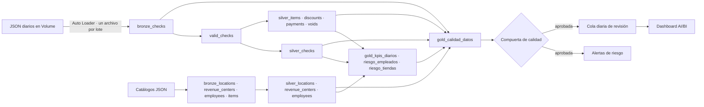
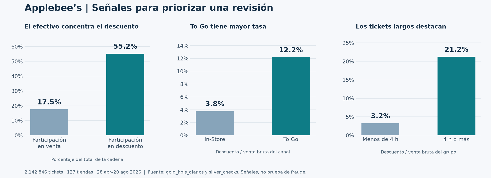

# Applebee's · Monitoreo de descuentos

Pipeline para el **Sun Holdings × Databricks Data Challenge** que convierte los tickets diarios de RMH Applebee's en datos conciliados y en un score de riesgo por empleado, para que operaciones sepa a quién y qué tienda revisar primero. El score prioriza la revisión; la decisión final la toma una persona.

**Datos:** 115 días de tickets (28 abr – 20 ago 2026) y cuatro catálogos JSON. Los datos viven en un volumen de Unity Catalog y no se suben a GitHub.

| Documento | Contenido |
|---|---|
| [Validación](docs/validacion.md) | Corridas, conteos y resultados verificados |
| [Requisitos de Fase 2](docs/fase2_requisitos.md) | Dónde se cubre cada criterio de la rúbrica |
| [Operación](docs/operacion.md) | Despliegue, horario, fallas, Repair run y full refresh |
| [Calidad](docs/calidad.md) | Reglas de calidad y excepciones |
| [Diccionario de tablas](docs/diccionario.md) · [Columnas gold](docs/diccionario_datos.md) | Grano, propósito y columnas |
| [Fase 3](docs/fase3.md) · [Modelo v2](docs/modelo_v2.md) | Cola diaria de revisión, modelo y resultados |
| [Demo](docs/demo_fase3.md) · [Guion](docs/fase3_guion.md) | Simulación de días nuevos y guion del pitch |

## Arquitectura



El job corre **pipeline → compuerta de calidad → alertas de riesgo y publicación de la cola**. Si una tarea falla, las siguientes no se ejecutan, así que nunca se emiten alertas con datos que no pasaron calidad. El pipeline es *triggered* (los datos llegan una vez al día), con programación diaria a las 06:00 `America/Chicago`, pausada mientras estamos en desarrollo. Solo se permite una corrida a la vez y hay reintentos para fallas transitorias.

## Organización

```text
├── databricks.yml        # Asset Bundle: variables y targets dev / qa
├── resources/
│   ├── jobs/             # Orquestación diaria y job de validación (qa)
│   └── pipelines/        # Pipeline Lakeflow serverless
├── src/
│   ├── transformations/
│   │   ├── bronze/       # Ingesta y catálogos
│   │   ├── silver/       # Aplanado, importes y dimensiones
│   │   └── gold/         # KPIs, riesgo y métricas de calidad
│   └── jobs/             # Compuerta de calidad y alertas
├── exploration/          # Notebooks del EDA (Fase 1)
├── tests/                # Pruebas unitarias y de aceptación
├── validation/sql/       # Consultas para verificar resultados
├── scripts/              # Validación local y evidencia
└── docs/
```

## Cómo ejecutarlo

```bash
python3 scripts/validate_local.py
databricks bundle validate -t qa
databricks bundle deploy -t qa
databricks bundle run daily_orchestration_job -t qa
databricks bundle run validation_job -t qa
```

Se necesita acceso de lectura al volumen, permisos para crear tablas en el catálogo y cómputo serverless. Cada target publica en su propio esquema (`workspace.applebees_<target>_<usuario>`) para que nadie sobrescriba las tablas de otro. Los parámetros `catalog`, `schema`, `source_path` y `failure_emails` se pueden cambiar por target; ver [operación](docs/operacion.md).

## Transformaciones y valor

| Tabla | Transformación principal | Uso |
|---|---|---|
| `bronze_checks` | Un registro por ticket con esquema explícito; guarda el JSON original, archivo de origen y motivo de rechazo | Trazabilidad y auditoría |
| `silver_checks` | Llave `LocationId + dt + CheckId`; importes en decimal; conciliación; tipo de pago; minutos abierto | Métricas por ticket |
| `silver_items` | Una fila por línea; modificadores a $0 marcados | Venta atribuible al empleado |
| `silver_discounts` | Descuentos de item y de ticket juntos; nombres normalizados; categoría y autorización | Saber quién descontó, quién autorizó y de qué tipo |
| `silver_payments` / `silver_voids` | Pagos y anulaciones por separado; propina con signo corregido | Revisión de pagos y anulaciones |
| Dimensiones silver | Tiendas, canales y empleados sin datos personales | Enriquecer sin duplicar filas |
| `gold_kpis_diarios` | Día × tienda × canal × tipo de pago | Tablero y tendencias |
| `gold_riesgo_empleados` | Empleado × tienda comparado contra la mediana de su tienda | Priorizar revisiones |
| `gold_riesgo_tiendas` | Agregados y empleados en riesgo por tienda | Dirigir visitas de operaciones |
| `gold_revision_descuentos` | Score por ticket contra sus 28 días previos y la conducta del empleado | Cola diaria de 20 tickets para revisar |
| `gold_calidad_datos` | Completitud, unicidad, referencias y conciliación | Decidir si se emiten alertas |

**Reglas contables (validadas en el EDA):** `GrossPrice` ya es total de línea. El descuento de item ya viene restado en `sold` y el de ticket se resta después, así que `descuento = disc_item + disc_check`, `venta_neta = sold − disc_check` y `paid = venta_neta + tax + tip`. `Gratuity` viene negativa en la fuente, por eso `tip = −Gratuity`. El efectivo se identifica con `PayCatName = CASH`; `IsCashDebit` no sirve para eso.

## Motor de riesgo

Se evalúa cada par **empleado–tienda** con al menos 100 líneas vendidas, comparado contra la mediana de su propia tienda para no castigar sucursales con más promociones.

| Señal | Puntos |
|---|---:|
| Tasa de descuento ≥ 3× la mediana de su tienda (≥ 2× suma 1) | 2 |
| ≥ 50 % de su descuento en tickets pagados en efectivo | 1 |
| ≥ 30 % en MANAGER o WALKOUT | 1 |
| ≥ 10 % de sus descuentos sin gerente registrado | 1 |
| Al menos una autoaprobación (mismo ID aplica y autoriza) | 1 |
| ≥ 5 tickets abiertos 4 h o más con descuento | 1 |

**Alto:** 4–7 · **Medio:** 2–3 · **Bajo:** 0–1. Los umbrales son un punto de partida para calibrar con prevención de pérdidas.

## Calidad y buenas prácticas

- **Ingesta incremental:** Auto Loader con checkpoints procesa solo archivos nuevos. Una segunda corrida sin archivos nuevos deja los mismos conteos e importes (probado).
- **Cuarentena y advertencias:** los tickets con errores graves se quedan en bronze con su JSON y el motivo, y la compuerta bloquea las alertas. Un campo nuevo, un artículo sin ID o una propina ausente solo generan una advertencia: el ticket sigue a silver.
- **Compuerta de calidad:** llaves únicas, mismos conteos entre capas, referencias válidas y conciliación ≥ 95 % global y por día.
- **Expectations:** reglas por tabla con métricas en cada corrida. Las anomalías de negocio se conservan y se cuentan.
- **Materialized views** para catálogos y gold; **liquid clustering** por fecha/tienda (y empleado en descuentos).
- **Privacidad:** nombre, fecha de nacimiento e `IsMinor` de empleados no salen de bronze; gold solo usa IDs.

## Resultados

**Carga completa:** 2,142,846 tickets · 127 tiendas · $87.32 M de venta · $3.02 M de descuento (3.46 %) · 0 llaves duplicadas · 99.996 % de tickets conciliados.

| Hallazgo | Resultado |
|---|---|
| Efectivo: % de la venta → % del descuento | 17.5 % → 55.2 % |
| Tasa de descuento To Go vs In-Store | 12.2 % vs 3.8 % (3.2×) |
| Tickets abiertos 4 h+ vs resto | 21.2 % vs 3.2 % |
| Descuento en tickets descontados al 100 % | 36.7 % ($1.11 M) |
| Empleados que descuentan ≥ 3× su tienda | 41 |
| Motor de riesgo (2,959 evaluados) | **34 Alto** · 937 Medio · 1,988 Bajo |

Los 34 de riesgo alto están en 26 tiendas. Detalle en [validación](docs/validacion.md).



## Fase 3: cola diaria de revisión

Cada día se arma una cola de 20 tickets con descuento para revisar primero. Cada ticket se compara con tickets parecidos de los 28 días anteriores (misma tienda, canal y forma de pago) y suma puntos por tasa inusual, autoaprobación, MANAGER/WALKOUT sin gerente, ticket de 4 h+ y conducta inusual del empleado. Para probarla con datos nuevos, simulamos días posteriores al dataset con abuso sembrado: en 7 días la cola encontró **45 de 56 empleado-días sembrados (80 %)**, contra 43 % de ordenar por monto. Detalle en [Fase 3](docs/fase3.md).

## Equipo

- José Rafael Gutiérrez Suárez
- Ebony Leticia Valadez Valverde
- César Morán Macías
- Juan Braulio Olivares Rodríguez
