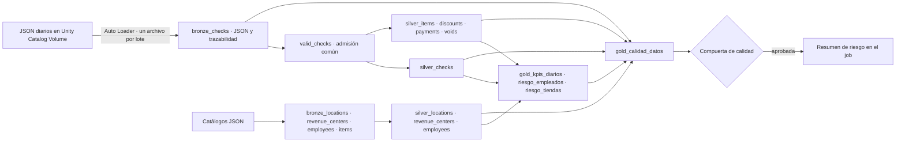

# Applebee's · Monitoreo de descuentos

Pipeline de **Sun Holdings × Databricks Data Challenge** que transforma tickets de RMH Applebee's en datos conciliados y señales explicables para priorizar revisiones de descuentos. El score orienta una revisión humana; no determina por sí solo abuso ni fraude.

**Fuente de referencia:** 115 días, del 28 de abril al 20 de agosto de 2026, más cuatro catálogos JSON. Los datos permanecen en el volumen de Unity Catalog y no se incluyen en GitHub.

- [Validación y evidencia de ejecución](docs/validacion.md)
- [Correspondencia con la rúbrica](docs/fase2_requisitos.md)
- [Despliegue, programación y recuperación](docs/operacion.md)
- [Contrato de calidad y excepciones](docs/calidad.md)
- [Diccionario de tablas](docs/diccionario.md)
- [Qué incluir en el commit](docs/entrega.md)

## Arquitectura



El job ejecuta **pipeline → compuerta de calidad → resumen de riesgo**. Las dependencias impiden emitir alertas cuando falla una tarea previa. El pipeline es triggered, con ejecución manual o programación diaria a las 06:00 `America/Chicago`, pausada en desarrollo. Hay una sola corrida concurrente y reintentos para errores transitorios.

## Organización

```text
├── databricks.yml                 # Variables y targets dev/qa aislados por usuario
├── resources/
│   ├── jobs/                      # Orquestación diaria y validación de QA
│   └── pipelines/                 # Lakeflow serverless
├── src/
│   ├── transformations/
│   │   ├── bronze/                # Ingesta, contrato y catálogos
│   │   ├── silver/                # Aplanado, importes y dimensiones
│   │   └── gold/                  # KPIs, riesgo y métricas de calidad
│   └── jobs/                      # Compuerta, reglas puras y resumen de riesgo
├── exploration/                   # Tres notebooks reproducibles de solo lectura
├── tests/unit/                    # Reglas de calidad sin infraestructura
├── tests/acceptance/              # Pruebas con Spark real y dataset completo
├── validation/sql/                # Consultas independientes de evidencia agregada
├── scripts/                       # Validación local y recolección de evidencia
├── docs/                          # Documentación de entrega
└── .github/workflows/              # Verificación local automática en push/PR
```

`.local/` contiene únicamente trabajo local ignorado: auditoría anterior, respuestas de API y registros de las pruebas. `.databricks/` contiene el estado local del bundle, también ignorado. Todo lo demás que aparece en `git status --short` forma parte de la entrega; consultar [el manifiesto](docs/entrega.md).

## Ejecutar y comprobar

```bash
python3 scripts/validate_local.py
databricks bundle validate -t qa -p APPLEBEES
databricks bundle plan -t qa -p APPLEBEES
databricks bundle deploy -t qa -p APPLEBEES
databricks bundle run daily_orchestration_job -t qa -p APPLEBEES
databricks bundle run validation_job -t qa -p APPLEBEES
```

Se requiere acceso al volumen, permisos para crear tablas y recursos en el catálogo de destino y serverless habilitado. Cambiar `APPLEBEES` por el perfil autenticado que corresponda. El target publica en `workspace.applebees_qa_<usuario>`, sin reutilizar por defecto las tablas de otra persona. El job de validación comprueba las transformaciones con datos sintéticos, los totales de referencia y la ejecución de los tres notebooks.

Los parámetros `catalog`, `schema`, `source_path` y `failure_emails` permiten configurar otras instancias. [La guía de operación](docs/operacion.md) explica permisos, variables, notificaciones, adopción del despliegue compartido y full refresh. Un push a `main` no despliega automáticamente Databricks.

## Transformaciones y valor

| Resultado | Transformación principal | Uso |
|---|---|---|
| `bronze_checks` | JSON por ticket, esquema explícito, detección de campos extra y errores, trazabilidad | Recuperar y auditar lo recibido |
| `silver_checks` | Llave compuesta; suma decimal de importes; conciliación; tipo de pago; duración | Base confiable de métricas por ticket |
| `silver_items` | Explosión de líneas; modificadores a $0 identificados | Venta y volumen atribuibles al empleado |
| `silver_discounts` | Unión de descuentos de item/ticket; nombres normalizados; categorías y autorización | Explicar el origen y control del descuento |
| `silver_payments` / `silver_voids` | Movimientos separados; propina con signo corregido; reversos preservados | Revisar pagos y anulaciones |
| Dimensiones silver | IDs consolidados; atributos necesarios; sin datos personales directos de empleados | Enriquecer sin multiplicar filas |
| `gold_kpis_diarios` | Día × tienda × canal × pago | Tendencias, comparaciones y futura visualización |
| `gold_riesgo_empleados` | Empleado × tienda; reglas contra su mediana local | Priorizar revisión de expedientes |
| `gold_riesgo_tiendas` | Agregados y conteo de empleados en riesgo por tienda | Dirigir capacidad de revisión de operaciones |
| `gold_calidad_datos` | Completitud, unicidad, referencias, conciliación y excepciones | Decidir si se pueden emitir alertas |

**Reglas contables:** `GrossPrice` ya incluye la cantidad; no se vuelve a multiplicar. `disc_item` ya está restado en `sold`; `disc_check` se resta después. Por tanto, `descuento = disc_item + disc_check`, `venta_neta = sold - disc_check` y `paid = venta_neta + tax + tip`. `tip = -Gratuity`, conservando anomalías de signo. `PayCatName`, normalizado, identifica efectivo; `IsCashDebit` no lo identifica correctamente.

## Motor de riesgo

Población: pares **empleado–tienda**, con ID positivo presente en el catálogo y al menos 100 líneas vendidas con precio positivo. La comparación usa la mediana de empleados elegibles de la misma tienda.

| Señal | Puntos |
|---|---:|
| Tasa de descuento ≥3× la mediana de su tienda; ≥2× suma uno | 2 |
| ≥50% del descuento en tickets de efectivo | 1 |
| ≥30% en MANAGER o WALKOUT | 1 |
| ≥10% de descuentos sin gerente identificado | 1 |
| Al menos una autoaprobación con IDs positivos e iguales | 1 |
| Al menos cinco tickets abiertos cuatro horas con descuento | 1 |

**Alto:** 4–7 · **Medio:** 2–3 · **Bajo:** 0–1. Divisiones entre cero quedan nulas y esa señal no suma puntos. Los umbrales requieren calibración con prevención de pérdidas; una señal frecuente en toda la cadena puede tener poco poder discriminante. La venta corresponde a líneas registradas por el empleado y el descuento a movimientos que aplicó; no es un cálculo de rentabilidad individual.

## Calidad y prácticas de ingeniería

- **Ingesta incremental:** Auto Loader y checkpoints procesan archivos nuevos e inmutables. Una segunda corrida sin nuevas entradas debe conservar conteos e importes. Cambios de lógica histórica requieren full refresh.
- **Cuarentena recuperable:** los tickets con errores conservan JSON y motivo en bronze. Tickets y detalles comparten la misma admisión a silver. La compuerta bloquea cualquier registro rescatado.
- **Completitud y exactitud:** comparación de conteos entre capas, llaves únicas, referencias válidas y conciliación ≥95% tanto global como por día. Montos `DECIMAL(18,2)` y tolerancia contable de $0.05.
- **Expectations:** errores y advertencias visibles por tabla. Anomalías comerciales se conservan y cuentan; no se eliminan para mejorar indicadores.
- **Materialized views:** catálogos y gold se actualizan según dependencias; Databricks elige actualización incremental o recálculo completo. No se promete incrementalidad para todos los planes.
- **Liquid clustering:** fecha/tienda y empleado en descuentos, según filtros previstos, sin particionado fijo.
- **Privacidad:** datos personales directos del catálogo de empleados limitados a bronze; consumidores con permisos sobre tablas necesarias. Los IDs siguen siendo seudónimos, no datos anónimos.
- **Reproducibilidad:** configuración declarativa, pruebas de errores y límites, consultas independientes, CI local y evidencia de ejecuciones reales.

## Resultados y decisiones de negocio

**Carga validada:** 2,142,846 tickets, 127 tiendas, $87.32 M de venta y $3.02 M de descuento. Cero llaves duplicadas y 99.99636% de conciliación. El score evalúa 2,959 pares empleado–tienda: 34 Alto, 937 Medio y 1,988 Bajo.

El [informe de validación](docs/validacion.md) registra los valores de la versión revisada, las corridas, las anomalías y las limitaciones. Las consultas en `validation/sql/` y el notebook `exploration/03_eda_descuentos.py` permiten reproducirlos sin tablas históricas externas al bundle.


Las comparaciones centrales son la participación del efectivo en venta frente a descuento, la tasa de To Go frente a In-Store, los tickets abiertos cuatro horas y la concentración de descuentos completos. Sirven para revisar autorización, cierre de tickets y diferencias de proceso. Los importes asociados a señales no equivalen a pérdidas confirmadas ni a ahorro prometido.

## Equipo

- José Rafael Gutiérrez Suárez
- Ebony Leticia Valadez Valverde
- César Morán Macías
- Juan Braulio Olivares Rodríguez
