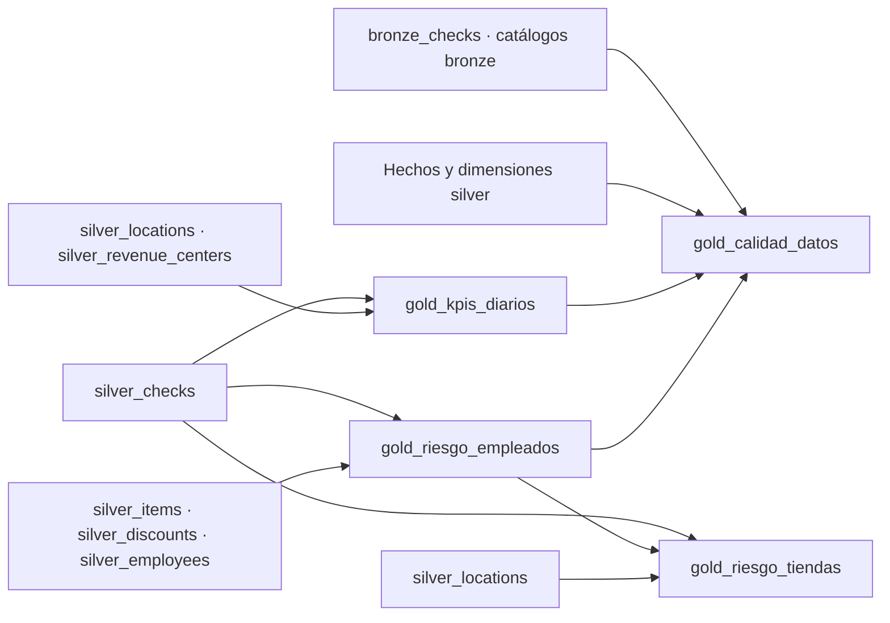

# Diccionario de datos — capa Gold

Este documento describe las tablas gold del proyecto de análisis de descuentos: qué representa cada fila, de dónde salen los datos y qué significa cada columna. El catálogo y esquema se definen mediante las variables del bundle; el destino por defecto es `workspace.applebees_<target>_<usuario>`. Los tipos de esta referencia se verificaron el 29 de octubre de 2026 contra el esquema de QA validado. El [diccionario general](diccionario.md) describe también bronze y silver.

## Resumen

| Tabla | Grano (una fila por…) | Para qué se usa | Archivo |
|---|---|---|---|
| `gold_kpis_diarios` | día × tienda × canal × tipo de pago | Base del tablero de descuentos | `mv_kpis_diarios.sql` |
| `gold_riesgo_empleados` | empleado × tienda | Motor de riesgo: identifica empleados con patrones de posible abuso | `mv_riesgo_empleados.py` |
| `gold_riesgo_tiendas` | tienda | Resumen de riesgo por sucursal para operaciones | `mv_riesgo_tiendas.sql` |
| `gold_calidad_datos` | una sola fila (todo el dataset) | Monitoreo de calidad; el job la lee para decidir si continúa | `mv_calidad_datos.sql` |

### Dependencias

`gold_riesgo_tiendas` depende de `gold_riesgo_empleados`, así que esta última debe actualizarse primero.

### Convenciones

- **Llave de un ticket:** `LocationId + dt + CheckId`. `CheckId` se reinicia por tienda y por día, así que por sí solo no es único.
- **Porcentajes:** las columnas `pct_*` son proporciones (0.25 = 25%), no valores multiplicados por 100. Los KPIs diarios exigen [0,1]. La tasa por empleado puede superar 1 porque atribuye ventas a quien las registró y descuentos a quien los aplicó; no es rentabilidad individual.
- **Divisiones:** se usa `try_divide`, que devuelve **nulo** cuando el denominador es 0 (por ejemplo, un empleado sin descuentos tiene `pct_efectivo` nulo).
- **Montos:** en la moneda del sistema de punto de venta.
- **Privacidad:** ninguna tabla gold incluye `Name`, `DateOfBirth` ni `IsMinor` de empleados. Los IDs son seudónimos, no datos anónimos; la tabla de riesgo también conserva fecha de contratación.

---

## `gold_kpis_diarios`

**Grano:** una fila por combinación de día, tienda, canal y tipo de pago.
**Fuente:** `silver_checks`, `silver_locations`, `silver_revenue_centers`.
**Uso:** base del tablero; permite filtrar y agregar por cualquiera de esas dimensiones.
**Regla de calidad:** `pct_desc` debe ser nulo o estar entre 0 y 1 (constraint `pct_desc_valido`; si no se cumple, se registra como advertencia). La compuerta también bloquea alertas ante tasas inválidas o discrepancias con el cociente de los totales a nueve decimales.

| Columna | Tipo | Descripción | Cálculo |
|---|---|---|---|
| `dt` | date | Fecha de operación | — |
| `LocationId` | bigint | ID de la tienda | — |
| `Tienda` | string | Nombre de la tienda | De `silver_locations` |
| `Canal` | string | Canal de venta (In-Store, To Go, Online, Delivery…) | De `silver_revenue_centers` |
| `tipo_pago` | string | Forma de pago de los tickets: `Efectivo`, `Tarjeta crédito`, `Mixto`, `Gift card`, `App delivery`, `Otro` o `Sin pago` | — |
| `tickets` | bigint | Número de tickets | `COUNT(*)` |
| `tickets_con_desc` | bigint | Tickets con al menos un descuento | Tickets con `descuento > 0` |
| `venta_bruta` | decimal(28,2) | Venta antes de descuentos | `SUM(gross)` |
| `descuento` | decimal(29,2) | Monto total descontado | `SUM(descuento)` |
| `propinas` | decimal(28,2) | Total de propinas | `SUM(tip)` |
| `tickets_100pct_desc` | bigint | Tickets con bruto positivo y neto ≤$0.01; incluye netos negativos que se monitorizan por separado | Conteo de `cien_pct_desc` |
| `tickets_abiertos_4h` | bigint | Tickets abiertos 4 horas o más | Conteo de `abierto_4h` |
| `pct_desc` | decimal(18,9) | Fracción de la venta bruta que se fue en descuentos | División segura de totales convertidos a DECIMAL(24,2), con resultado DECIMAL(18,9) |

**Ojo al agregar:** para obtener `pct_desc` de una tienda o de un mes no se deben promediar los `pct_desc` diarios; hay que sumar `descuento` y `venta_bruta` y luego dividir.

---

## `gold_riesgo_empleados`

**Grano:** una fila por empleado en una tienda.
**Fuente:** `silver_items`, `silver_discounts`, `silver_checks`, `silver_employees`.
**Uso:** motor de riesgo con reglas explicables. Cada empleado se compara contra **su propia tienda**, porque cada sucursal tiene niveles normales de descuento distintos.
**Filtros:**
- Solo IDs positivos presentes en `silver_employees`; identidades desconocidas permanecen en los movimientos, pero no reciben score.
- Solo se cuentan líneas de venta con `GrossPrice > 0` (se excluyen modificadores como salsas o cubiertos).
- Solo se cuentan descuentos con `Amount > 0`.
- Solo se incluyen empleados con **al menos 100 líneas** de venta (`MIN_LINEAS`), para no juzgar con muestras pequeñas.

**Regla de calidad:** `score_riesgo` debe estar entre 0 y 7 (expectation `score_valido`).

### Volumen

| Columna | Tipo | Descripción | Cálculo |
|---|---|---|---|
| `EmployeeId` | bigint | ID del empleado | — |
| `LocationId` | bigint | ID de la tienda | — |
| `venta_emp` | decimal(28,2) | Venta bruta que registró el empleado | `SUM(GrossPrice)` de sus líneas |
| `lineas` | bigint | Líneas de venta que registró | Conteo (siempre ≥ 100) |
| `desc_emp` | decimal(28,2) | Monto total que descontó | `SUM(Amount)` de sus descuentos |
| `n_desc` | bigint | Número de descuentos que aplicó | Conteo |

### Indicadores de riesgo

| Columna | Tipo | Descripción | Cálculo |
|---|---|---|---|
| `pct_desc` | decimal(38,10) | Fracción de su venta que descontó | `desc_emp / venta_emp` |
| `mediana_tienda` | decimal(38,10) | Lo "normal" en su tienda: mediana de `pct_desc` de los empleados elegibles de esa tienda | `percentile_approx(pct_desc, 0.5)` por tienda |
| `veces_vs_tienda` | decimal(38,6) | Cuántas veces descuenta el empleado comparado con lo normal en su tienda | `pct_desc / mediana_tienda`. **1** = igual que la mediana, **2** = el doble, **3** = el triple. Es nulo si la mediana de la tienda es 0 |
| `desc_efectivo` | decimal(28,2) | Monto de sus descuentos aplicado en tickets pagados en efectivo | Suma de `Amount` cuando `tipo_pago = 'Efectivo'` |
| `pct_efectivo` | decimal(38,10) | Fracción de **su monto descontado** que cayó en tickets en efectivo | `desc_efectivo / desc_emp`. Mide concentración del descuento; requiere contexto operativo. No es el % de pagos en efectivo |
| `desc_manager_walkout` | decimal(28,2) | Monto descontado con los códigos `MANAGER` (descuento discrecional del gerente) o `WALKOUT` (compensación cuando el cliente se va sin pagar). Su concentración justifica revisar la evidencia de autorización | Suma de `Amount` para esos `DiscountName` |
| `pct_manager_walkout` | decimal(38,10) | Fracción de su monto descontado que usó `MANAGER` o `WALKOUT` | `desc_manager_walkout / desc_emp` |
| `n_sin_gerente` | bigint | Descuentos sin gerente identificado (ID nulo o no positivo) | Conteo de `sin_gerente` |
| `pct_sin_gerente` | double | Fracción de sus descuentos sin gerente | `n_sin_gerente / n_desc` |
| `n_autoaprobados` | bigint | Descuentos con IDs positivos e iguales de empleado y gerente | Conteo de `autoaprobado` |
| `tickets_4h_con_desc` | bigint | Tickets distintos abiertos 4 h+ en los que aplicó descuentos | Conteo distinto de tickets con `abierto_4h` |

### Score

| Columna | Tipo | Descripción | Cálculo |
|---|---|---|---|
| `score_riesgo` | int | Puntaje de riesgo de **0 a 7**. Más alto = más señales de posible abuso | Suma de las reglas de la tabla siguiente |
| `nivel_riesgo` | string | Clasificación del score | `Alto` si score ≥ 4; `Medio` si score 2–3; `Bajo` si score 0–1 |

**Reglas del score:**

| Regla | Condición | Puntos |
|---|---|---|
| Descuenta mucho más que su tienda | `veces_vs_tienda ≥ 3` | 2 |
| | `veces_vs_tienda ≥ 2` (y < 3) | 1 |
| Descuentos concentrados en efectivo | `pct_efectivo ≥ 0.5` | 1 |
| Uso fuerte de MANAGER/WALKOUT | `pct_manager_walkout ≥ 0.3` | 1 |
| Sin gerente identificado | `pct_sin_gerente ≥ 0.1` | 1 |
| Se autoaprueba descuentos | `n_autoaprobados > 0` | 1 |
| Descuentos en tickets abiertos mucho tiempo | `tickets_4h_con_desc ≥ 5` | 1 |
| | **Máximo posible** | **7** |

Si un indicador es nulo (por ejemplo, `veces_vs_tienda` cuando la mediana de la tienda es 0), esa regla suma 0 puntos.

**Interpretación:** el score señala a quién revisar primero, no prueba que haya abuso. Un score alto puede tener explicaciones legítimas (por ejemplo, un gerente que aplica más descuentos por su rol).

### Antigüedad

| Columna | Tipo | Descripción | Cálculo |
|---|---|---|---|
| `HireDate` | string | Fecha de contratación, como texto tal cual viene del catálogo de empleados | De `silver_employees` |
| `anios_antiguedad` | bigint | Antigüedad aproximada en años a la fecha de corte; no calcula aniversarios exactos | `floor(días entre HireDate y la fecha máxima de los datos / 365)`. Nulo si no hay `HireDate` |

---

## `gold_riesgo_tiendas`

**Grano:** una fila por tienda.
**Fuente:** `silver_checks`, `gold_riesgo_empleados`, `silver_locations`.
**Uso:** resumen para operaciones; permite priorizar qué sucursales auditar.

| Columna | Tipo | Descripción | Cálculo |
|---|---|---|---|
| `LocationId` | bigint | ID de la tienda | — |
| `Tienda` | string | Nombre de la tienda | De `silver_locations` |
| `tickets` | bigint | Número de tickets | `COUNT(*)` |
| `venta_bruta` | decimal(28,2) | Venta antes de descuentos | `SUM(gross)` |
| `descuento` | decimal(29,2) | Monto total descontado | `SUM(descuento)` |
| `pct_desc` | decimal(38,9) | Fracción de la venta que se fue en descuentos | `descuento / venta_bruta` |
| `pct_desc_en_efectivo` | decimal(38,9) | Fracción del descuento de la tienda que cayó en tickets en efectivo | Descuento en tickets `Efectivo` / `descuento` |
| `pct_desc_en_abiertos_4h` | decimal(38,9) | Fracción del descuento de la tienda que cayó en tickets abiertos 4 h+ | Descuento en tickets `abierto_4h` / `descuento` |
| `tickets_100pct_desc` | bigint | Tickets con bruto positivo y neto ≤$0.01; incluye netos negativos que se monitorizan por separado | Conteo de `cien_pct_desc` |
| `empleados_riesgo_alto` | bigint | Empleados de la tienda con `nivel_riesgo = 'Alto'` | De `gold_riesgo_empleados`; 0 si no hay |
| `empleados_riesgo_medio` | bigint | Empleados de la tienda con `nivel_riesgo = 'Medio'` | De `gold_riesgo_empleados`; 0 si no hay |

Los conteos solo consideran pares empleado–tienda con identidad válida y al menos 100 líneas de precio positivo en `gold_riesgo_empleados`.

---

## `gold_calidad_datos`

**Grano:** una sola fila con métricas del dataset completo.
**Fuentes:** bronze de tickets y catálogos, hechos y dimensiones silver, `gold_kpis_diarios` y `gold_riesgo_empleados`; las dependencias exactas están en [mv_calidad_datos.sql](../src/transformations/gold/mv_calidad_datos.sql).
**Uso:** la compuerta se ejecuta después de actualizar el pipeline y bloquea la tarea de alertas si falla un control crítico. No revierte las tablas ya actualizadas.

| Columna | Tipo | Descripción | Política |
|---|---|---|---|
| `tickets` | bigint | Total de tickets en silver | Mayor que 0; crítico |
| `dias` | bigint | Días distintos con datos | Informativo |
| `tiendas` | bigint | Tiendas distintas con datos | Informativo |
| `archivos` | bigint | Archivos de origen distintos en bronze | Informativo |
| `llaves_duplicadas` | bigint | Combinaciones LocationId + dt + CheckId con más de una fila | 0; crítico |
| `pct_tickets_conciliados` | decimal(6,5) | Fracción con paid = sold − disc_check + tax + tip dentro de ±$0.05 | Entre 0.95 y 1; crítico |
| `min_pct_conciliado_diario` | decimal(6,5) | Menor fracción de conciliación entre los días publicados | Entre 0.95 y 1; crítico |
| `registros_rescatados` | bigint | Filas de bronze con diagnóstico: ticket inválido o fila de diagnóstico de archivo vacío/ilegible | 0; crítico |
| `diferencia_tickets` | bigint | Diferencia absoluta entre tickets admitidos en bronze y publicados en silver | 0; crítico |
| `diferencia_items` | bigint | Diferencia absoluta entre líneas esperadas en tickets admitidos y silver_items | 0; crítico |
| `diferencia_descuentos` | bigint | Diferencia absoluta entre descuentos de item/ticket esperados y silver_discounts | 0; crítico |
| `diferencia_pagos` | bigint | Diferencia absoluta entre pagos esperados y silver_payments | 0; crítico |
| `diferencia_voids` | bigint | Diferencia absoluta entre anulaciones esperadas y silver_voids | 0; crítico |
| `tickets_sin_tienda` | bigint | Tickets cuyo LocationId no enlaza con silver_locations | 0; crítico |
| `tickets_sin_canal` | bigint | Tickets cuyo canal no enlaza con silver_revenue_centers | 0; crítico |
| `dimensiones_invalidas` | bigint | Grupos de catálogo con ID inválido o atributos contradictorios según el contrato | 0; crítico |
| `identidades_invalidas_en_riesgo` | bigint | Filas del score sin enlace a un EmployeeId positivo del catálogo | 0; crítico |
| `kpis_pct_invalidos` | bigint | KPIs diarios con tasa no nula fuera de [0,1] | 0; crítico |
| `kpis_tasa_inconsistente` | bigint | KPIs cuya tasa no coincide con descuento / venta_bruta a nueve decimales, incluyendo discrepancias de nulos | 0; crítico |
| `tickets_sin_items` | bigint | Tickets sin líneas de productos | Observación; conservar |
| `tickets_horario_invalido` | bigint | Tickets con duración nula o negativa | Observación; revisar |
| `tickets_descuento_supera_bruto` | bigint | Tickets cuyo descuento excede el bruto en más de $0.05 | Observación; revisar |
| `tickets_items_no_conciliados` | bigint | Tickets donde abs(gross − sold − disc_item) > $0.05 | Observación; revisar |
| `items_bruto_negativo` | bigint | Líneas de item con GrossPrice < 0 | Observación; conservar |
| `descuentos_monto_cero` | bigint | Movimientos de descuento con Amount = 0 | Informativo; fuera del score |
| `descuentos_negativos` | bigint | Movimientos de descuento con Amount < 0 | Observación; revisar |
| `descuentos_identidad_desconocida` | bigint | Descuentos sin enlace a un EmployeeId positivo del catálogo | Observación; movimiento conservado, identidad fuera del score |
| `voids_monto_cero` | bigint | Anulaciones con Amount = 0 | Informativo |
| `pagos_negativos` | bigint | Movimientos de pago con Amount < 0 | Observación; conservar reversos y revisar semántica |
| `propinas_con_signo_invertido` | bigint | Pagos con Tip < 0 después de aplicar Tip = −Gratuity | Observación; conservar |
| `fecha_corte` | date | Fecha de negocio máxima de silver_checks | Informativo; dataset histórico de la competencia |
| `calculado_en` | timestamp | Momento de cálculo de las métricas | Informativo; no equivale a llegada de datos nuevos |

La compuerta exige exactamente una fila, valida que las métricas críticas estén presentes y sean finitas y que sus contadores sean enteros no negativos. Las excepciones observadas no se borran para mejorar los indicadores; su tratamiento está en [calidad.md](calidad.md). Los ratios de conciliación publicados tienen cinco decimales; para una tasa más precisa se deben usar los conteos de tickets y de excepciones.
