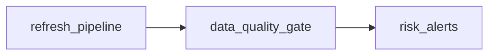

# Despliegue, operación y recuperación

Cómo desplegar el pipeline, qué hace el job cuando algo falla, cuándo hacer full refresh y cómo activar el horario.

## Requisitos

- Databricks CLI autenticada (`databricks auth profiles`).
- Workspace con Unity Catalog, Lakeflow Declarative Pipelines y serverless.
- Permisos `USE CATALOG` y `CREATE SCHEMA` en el catálogo destino; `CREATE TABLE` en el esquema; permiso para crear y correr jobs y pipelines.
- `READ VOLUME` sobre el volumen de origen.
- Python 3.11+ para las pruebas locales (no necesitan Spark ni credenciales).

El volumen debe tener `facts/checks/brand=rmh/dt=AAAA-MM-DD/checks.json` y `dimensions/*/*.json`. Cada archivo de tickets es un arreglo JSON.

## Despliegue

```bash
python3 scripts/validate_local.py
databricks bundle validate -t qa
databricks bundle plan -t qa
databricks bundle deploy -t qa
databricks bundle run daily_orchestration_job -t qa
databricks bundle run validation_job -t qa
```

`dev` es el target por defecto. Cada target publica en `workspace.applebees_<target>_<usuario>`, con su propio estado y checkpoints, así cada integrante puede probar sin pisar las tablas de otro. `qa` agrega el job de validación (pruebas con Spark, totales del dataset y los tres notebooks de exploración).

Variables: `catalog`, `schema`, `source_path` y `failure_emails`. Ejemplo:

```bash
databricks bundle deploy -t dev \
  --var 'catalog=workspace,schema=applebees_dev_personal,source_path=/Volumes/workspace/default/applebees'
```

Para fijar valores sin escribirlos cada vez se usa `.databricks/bundle/<target>/variable-overrides.json` (ignorado por Git).

### Actualizar el esquema compartido `workspace.applebees`

Un push a GitHub no despliega nada. Quien desplegó originalmente debe usar su mismo perfil y target con `--var schema=applebees` y revisar `bundle plan` para confirmar que actualiza el pipeline existente en vez de crear otro. Como esta versión cambió bronze y los tipos de silver, la primera actualización necesita full refresh:

```bash
databricks bundle deploy -t dev --var schema=applebees
databricks bundle run applebees_pipeline -t dev --var schema=applebees --full-refresh-all
databricks bundle run daily_orchestration_job -t dev --var schema=applebees
```

## Diseño del job



| Tarea | Qué hace | Reintentos | Si falla |
|---|---|---|---|
| `refresh_pipeline` | Actualiza bronze, silver y gold (incremental) | 2, cada 5 min | No corren la compuerta ni las alertas |
| `data_quality_gate` | Revisa `gold_calidad_datos` | 0 | Bloquea las alertas |
| `risk_alerts` | Lista empleados y tiendas en riesgo alto | 1, después de 1 min | El job falla; se repara solo esta tarea |

La compuerta no tiene reintentos a propósito: si los datos están mal, reintentar no lo arregla. `max_concurrent_runs: 1` evita dos corridas al mismo tiempo. El pipeline es serverless y triggered porque los archivos llegan una vez al día; uno continuo costaría más sin aportar nada. Los avisos de falla van a `failure_emails` (vacío en QA).

## Si falla el job: Repair run

1. En **Jobs & Pipelines → Runs**, abrir la corrida fallida e identificar la primera tarea que falló (las siguientes aparecen como omitidas).
2. Leer el error. Si fue `refresh_pipeline`, revisar también los eventos del pipeline; si fue la compuerta, las métricas que imprime.
3. Corregir la causa (permisos, configuración, datos o código) y desplegar. No bajar umbrales para que pase.
4. Usar **Repair run**: vuelve a correr solo las tareas fallidas y las que dependen de ellas.

| Causa | Qué volver a correr |
|---|---|
| Falla temporal del pipeline | Repair desde `refresh_pipeline` |
| Error de lectura en la compuerta, datos sin cambios | Repair de compuerta y alertas |
| Datos o transformación incorrectos | Corregir, actualizar el pipeline (full refresh si aplica) y correr el job completo |
| Falla temporal de alertas | Repair solo de `risk_alerts` |

Para investigar un problema de calidad:

```sql
SELECT * FROM workspace.<esquema>.gold_calidad_datos;
SELECT _source_file, _rescued_data, COUNT(*) AS registros
FROM workspace.<esquema>.bronze_checks
WHERE _rescued_data IS NOT NULL
GROUP BY ALL;
```

## Cuándo hacer full refresh

| Situación | Qué hacer |
|---|---|
| Llegan archivos diarios nuevos | Corrida normal (incremental) |
| Falla de cómputo o permisos | Corregir y Repair run; no borrar checkpoints |
| Cambia la lógica de bronze o silver y debe aplicarse al histórico | Full refresh |
| Se corrige un archivo que ya se había procesado | Reemplazar el archivo y full refresh |
| Cambia solo una vista gold | Corrida normal; la vista se recalcula sola |

El full refresh vacía las streaming tables y reinicia sus checkpoints, así que todos los archivos de origen deben seguir disponibles. Antes de hacerlo, pausar el horario y esperar a que no haya corridas activas.

## La compuerta de calidad

`src/jobs/dq_gate.py` lee `gold_calidad_datos` y aplica las reglas de `src/jobs/quality_rules.py`:

| Regla | Criterio |
|---|---|
| Hay datos | `tickets > 0` y exactamente una fila de métricas |
| Unicidad | `llaves_duplicadas = 0` |
| Esquema | `registros_rescatados = 0` |
| Completitud bronze → silver | Diferencia 0 en tickets, items, descuentos, pagos y voids |
| Referencias | 0 tickets sin tienda o canal, 0 catálogos contradictorios, 0 empleados inválidos en el score |
| Tasas gold | 0 porcentajes fuera de [0, 1] y 0 tasas inconsistentes con sus totales |
| Conciliación | ≥ 95 % global y ≥ 95 % en el peor día |

Un ticket concilia si `abs(paid − (sold − disc_check + tax + tip)) ≤ 0.05`. Si todo pasa, imprime `Calidad OK: el job continúa.`; si no, lanza un error y las alertas no se emiten. Las excepciones de negocio (pagos negativos, tickets sin items) se cuentan pero no bloquean; ver [calidad](calidad.md).

## Activar o pausar el horario

El job corre todos los días a las 06:00 `America/Chicago` (`0 0 6 * * ?`) y está en `PAUSED`. Para activarlo en un target, se agrega dentro de ese target en `databricks.yml`:

```yaml
targets:
  dev:
    resources:
      jobs:
        daily_orchestration_job:
          schedule:
            pause_status: UNPAUSED
```

Después `bundle deploy` y se revisa en la interfaz que la próxima ejecución aparezca programada. Para detenerlo se regresa a `PAUSED` y se despliega de nuevo.

## Permisos y datos personales

Bronze contiene los catálogos con datos personales, así que solo el equipo de ingeniería debería tener acceso. Silver de empleados excluye `Name`, `DateOfBirth` e `IsMinor`, y gold solo usa IDs y agregados. A quien consuma el tablero se le dan permisos solo sobre las tablas gold.

## Costo y técnicas

Auto Loader y silver son incrementales gracias a los checkpoints. Las materialized views las mantiene Databricks: los KPIs se actualizan de forma incremental y el score se recalcula completo porque usa medianas. `maxFilesPerTrigger = 1` evita quedarse sin memoria con los archivos de 70–90 MB. Liquid clustering por fecha/tienda (y empleado en descuentos) acelera los filtros más comunes sin particionado fijo.

## Prueba de idempotencia

```bash
python3 scripts/collect_evidence.py --warehouse-id ID --schema ESQUEMA --only idempotencia.sql --output antes.json
databricks bundle run daily_orchestration_job -t qa
python3 scripts/collect_evidence.py --warehouse-id ID --schema ESQUEMA --only idempotencia.sql --output despues.json
python3 scripts/compare_evidence.py antes.json despues.json
```
