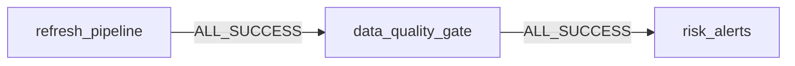

# Despliegue, operación y recuperación

**Responsable del documento:** César Morán Macías. **Criterio:** Job & Pipeline Design. Esta guía describe la configuración versionada y los pasos para operar y recuperar el job. La correspondencia disponible con la rúbrica está en [Fase 2](fase2_requisitos.md); las corridas comprobadas están en [validación](validacion.md). Los procedimientos de reparación y activación siguientes son instrucciones operativas, no evidencia de que ya se hayan ejecutado.

## Correspondencia con las guías de presentación

Se contrastó esta guía con los documentos proporcionados por el equipo: *Fase1_alineacion_rubrica.pdf* (2 páginas) y *Fase2_guia_completa.pdf* (10 páginas). El primero alinea el EDA con criterios de Fase 1; el segundo explica el proyecto y propone un guion, pero no reproduce la rúbrica oficial completa de Fase 2. La asignación de este documento a **Job & Pipeline Design** sigue la distribución del equipo y la cobertura registrada en [fase2_requisitos.md](fase2_requisitos.md).

| Tema de la guía de Fase 2 | Dónde queda cubierto aquí |
|---|---|
| Página 5: tres tareas, dependencias, reintentos, concurrencia y modo triggered | Diseño del job y comportamiento ante fallos |
| Páginas 5 y 10: recuperación y reproceso | Diagnóstico y Repair run; cuándo hacer full refresh; prueba de idempotencia |
| Página 5: bloqueo por calidad | Qué revisa la compuerta, con todas las métricas y umbrales del código actual |
| Páginas 5 y 9: horario diario pausado y futura activación | Cómo activar o pausar el horario, con override por target y comprobación posterior |

**Precisiones para exponer la versión actual:** la guía de Fase 2 refiere cifras de la corrida del 28 de octubre de 2026. Para resultados posteriores usar [validacion.md](validacion.md), que identifica la versión y las corridas. No afirmar que el horario ya está activo, que hay correos configurados por defecto o que todo vive en `workspace.applebees`: el bundle actual mantiene el horario pausado, `failure_emails: []` y esquemas por usuario/target. Decir «conciliación con tolerancia de $0.05», no «al centavo». Repair run incluye las tareas dependientes necesarias; full refresh se decide según el efecto sobre el histórico, no ante cualquier cambio de código. La idempotencia está comprobada para la versión y los datos documentados, no garantizada para cualquier modificación futura.

## Requisitos y acceso

- Databricks CLI autenticada (`databricks auth profiles`; en la validación se usó `APPLEBEES`).
- Workspace con Unity Catalog, Lakeflow Spark Declarative Pipelines y cómputo serverless habilitados.
- `USE CATALOG`, `CREATE SCHEMA` en el catálogo de destino; `USE SCHEMA`, `CREATE TABLE` y permisos para materialized views/streaming tables en el esquema; acceso para crear/ejecutar jobs y pipelines.
- `USE CATALOG`, `USE SCHEMA` y `READ VOLUME` en el volumen de origen.
- Python 3.11+ para las verificaciones locales. No requiere instalar Spark ni credenciales para esas pruebas.

El volumen debe contener `facts/checks/brand=rmh/dt=AAAA-MM-DD/*.json` y `dimensions/*/{locations,revenueCenters,employees,items}.json`. Cada archivo de tickets contiene un arreglo JSON. La entrega de referencia contiene 115 archivos diarios más cuatro catálogos. No subir datos, tokens ni resultados individuales a GitHub.

## Validación y despliegue independiente

```bash
python3 scripts/validate_local.py
databricks bundle validate -t qa -p APPLEBEES
databricks bundle plan -t qa -p APPLEBEES
databricks bundle deploy -t qa -p APPLEBEES
databricks bundle run daily_orchestration_job -t qa -p APPLEBEES
databricks bundle run validation_job -t qa -p APPLEBEES
# Repetir sin nuevos archivos: debe conservar los conteos y los importes.
databricks bundle run daily_orchestration_job -t qa -p APPLEBEES
```

`dev` es el target por defecto. Cada target publica en `workspace.applebees_<target>_<usuario>`, por ejemplo `workspace.applebees_qa_a01706880`. El estado y los checkpoints se mantienen por usuario/target. `qa` añade un job de pruebas que ejecuta las transformaciones productivas con datos sintéticos, verifica los totales del dataset de la competencia y ejecuta los tres notebooks de exploración. Sus comprobaciones de volumen exacto se deben actualizar deliberadamente cuando se amplíe ese dataset.

Variables: `catalog`, `schema`, `source_path` y `failure_emails`. Ejemplo de instancia independiente:

```bash
databricks bundle validate -t dev -p APPLEBEES \
  --var 'catalog=workspace,schema=applebees_dev_personal,source_path=/Volumes/workspace/default/applebees'
```

Usar los mismos valores en `validate`, `plan`, `deploy` y `run`. Para valores persistentes, crear `.databricks/bundle/<target>/variable-overrides.json` (ignorado por Git). Las notificaciones están vacías durante QA; configurar `failure_emails` con destinatarios autorizados para la operación compartida. El job registra errores aunque no haya correo configurado.

## Actualizar la instancia compartida existente

El esquema histórico `workspace.applebees` pertenece al pipeline original. Un push a GitHub **no despliega** automáticamente el bundle ni actualiza ese esquema. No apuntar un nuevo pipeline a tablas que ya administra otro.

La ruta recomendada es que el responsable del despliegue original use su mismo perfil, target y estado del bundle, con `--var schema=applebees`. Primero revisar `bundle plan`: debe actualizar el pipeline y job existentes, no crear otro pipeline para esas tablas. Si se cambia de responsable, acordar la transferencia y usar `bundle deployment bind` para ambos recursos; vincular no sustituye los permisos, ni evita conflictos con el estado del responsable anterior.

Esta versión cambia el contrato de bronze y los tipos monetarios de silver. La primera actualización de una instancia previa requiere **full refresh** para aplicar la lógica a los 115 días. Validar antes en QA, conservar los archivos fuente y programar una ventana sin lectores de resultados parcialmente reconstruidos:

```bash
# Solo con el estado correcto de la instancia compartida y su responsable:
databricks bundle deploy -t dev -p PERFIL_RESPONSABLE --var schema=applebees
databricks bundle run applebees_pipeline -t dev -p PERFIL_RESPONSABLE \
  --var schema=applebees --full-refresh-all
databricks bundle run daily_orchestration_job -t dev -p PERFIL_RESPONSABLE --var schema=applebees
```

El full refresh reinicia las tablas y checkpoints de ese pipeline: requiere que todas las fuentes históricas sigan disponibles. La validación de esta entrega se hizo en un esquema aislado y deja intacta la instancia histórica.

## Diseño del job y comportamiento ante fallos

La configuración está en [daily_orchestration_job.yml](../resources/jobs/daily_orchestration_job.yml) y [lakeflow_pipeline.yml](../resources/pipelines/lakeflow_pipeline.yml).



| Tarea | Función | Reintentos configurados | Si falla definitivamente |
|---|---|---|---|
| `refresh_pipeline` | Actualiza bronze, silver y gold; `full_refresh: false` | Dos adicionales, intervalo mínimo de cinco minutos | No se ejecutan compuerta ni alertas |
| `data_quality_gate` | Lee y valida `gold_calidad_datos` | Ninguno | Bloquea `risk_alerts` |
| `risk_alerts` | Muestra empleados y tiendas para revisión humana | Uno adicional, intervalo mínimo de un minuto | El job falla; revisar salida y reparar esta tarea |

Las dependencias usan `ALL_SUCCESS`, valor predeterminado al omitir `run_if`. `max_concurrent_runs: 1` evita dos corridas simultáneas del job; también se debe evitar iniciar manualmente el pipeline durante una corrida. El pipeline es serverless y triggered (`continuous: false`), adecuado para archivos diarios. La ejecución incremental conserva checkpoints; las materialized views pueden recalcularse según su plan.

El resumen de riesgo solo aparece en la salida del notebook; no envía tickets ni correos de negocio. `email_notifications.on_failure` usa `failure_emails`, vacío por defecto. Sin destinatarios hay registro del fallo, pero no aviso por correo.

## Qué hacer si falla el job: diagnóstico y Repair run

1. En **Jobs & Pipelines**, abrir el job del target correcto y su pestaña **Runs**. Localizar la corrida fallida y registrar URL/run ID, target, catálogo/esquema, versión desplegada y primera tarea que falló. Distinguir el fallo original de las tareas omitidas por dependencia.
2. Abrir la tarea y leer su salida/error. Para `refresh_pipeline`, abrir también la actualización del pipeline y sus eventos. Para `data_quality_gate`, revisar las métricas impresas y el mensaje `Falló la compuerta de calidad`.
3. Corregir la causa: disponibilidad/permisos, configuración, contrato de entrada o transformación. Desplegar los cambios de código con el mismo perfil, target y estado del bundle. No reducir umbrales ni saltarse la compuerta para terminar en verde.
4. Cuando la corrida ya haya terminado, abrir **Repair run**, revisar las tareas seleccionadas y sus dependientes y confirmar la reparación. La reparación usa la configuración actual y reinicia las tareas seleccionadas desde el comienzo; no continúa una celda interrumpida. Ver [reparación de jobs](https://docs.databricks.com/aws/en/jobs/repair-job-failures).
5. Comprobar el éxito del job reparado y de las tres tareas, incluidas las que ya habían terminado correctamente. Guardar el enlace al intento reparado, causa, corrección y métricas de cierre.

| Causa resuelta | Qué volver a ejecutar |
|---|---|
| Fallo transitorio de `refresh_pipeline` | Reparar pipeline y dependientes: compuerta y alertas |
| Fallo de lectura/permisos en la compuerta, con pipeline correcto y datos sin cambios | Reparar compuerta y alertas |
| Calidad incorrecta por datos o transformaciones | Actualizar primero el pipeline; aplicar full refresh si corresponde a la tabla de decisiones siguiente. Ejecutar después el job completo para validar los datos reconstruidos |
| Fallo transitorio de `risk_alerts`, con calidad aprobada y datos sin cambios | Reparar únicamente alertas |

Reparar solo la compuerta no recalcula `gold_calidad_datos`. Si cambió la versión o los datos después del fallo, una corrida completa nueva deja evidencia más clara de la cadena validada.

Para investigar calidad, sustituir `CATALOGO.ESQUEMA` por el destino de la corrida:

```sql
SELECT * FROM CATALOGO.ESQUEMA.gold_calidad_datos;
SELECT _source_file, _rescued_data, COUNT(*) AS registros
FROM CATALOGO.ESQUEMA.bronze_checks
WHERE _rescued_data IS NOT NULL
GROUP BY _source_file, _rescued_data;
```

Consultar las fuentes originales solo con acceso autorizado. Un fallo no revierte tablas ya materializadas. El repositorio no implementa un snapshot publicado ni un cambio atómico entre versiones: los consumidores deben verificar el éxito de la corrida y suspender el uso de resultados afectados durante la recuperación.

## Cuándo hacer full refresh

| Situación | Decisión |
|---|---|
| Llegan archivos diarios nuevos e inmutables | Corrida normal incremental; no full refresh |
| Falla cómputo, acceso o una tarea de lectura | Corregir y reparar; no borrar checkpoints |
| Cambia la lógica/tipo de bronze o silver y debe aplicarse a registros ya consumidos | Full refresh para reconstruir el histórico |
| Se corrige o reemplaza un archivo que Auto Loader ya procesó | Corrección controlada de la fuente y full refresh; una corrida normal no garantiza releerlo |
| Cambia únicamente una consulta de una materialized view gold | Primero actualización normal: debe reflejar la consulta vigente; no implica por sí sola reiniciar bronze/silver |
| Se requiere reconstrucción por pérdida de estado o migración incompatible | Full refresh solo después de verificar que las fuentes permiten reconstruir el histórico completo |

El full refresh vacía las streaming tables y reinicia sus checkpoints; las materialized views se recalculan. Un simple reset de checkpoints conserva las filas y puede reingerir datos: no es sustituto de esta reconstrucción. Véase [semántica de refresco](https://docs.databricks.com/aws/en/ldp/updates).

Antes de reconstruir, pausar el horario si estaba activo, esperar a que no haya corridas, confirmar destino/propietario, disponibilidad de todos los archivos y corrección validada en QA. El ejemplo reconstruye **todo el pipeline** del target indicado; no elimina selectivamente un día:

```bash
# Ejemplo en QA: conservar el perfil y las variables usados al desplegar.
databricks bundle run applebees_pipeline -t qa -p APPLEBEES --full-refresh-all
databricks bundle run daily_orchestration_job -t qa -p APPLEBEES
databricks bundle run validation_job -t qa -p APPLEBEES
```

Para la instancia compartida, usar el procedimiento de adopción anterior. La prueba de QA incluye conteos del dataset fijo y debe adaptarse deliberadamente si se amplía la fuente. Confirmar conteos, conciliación y éxito de las tres tareas antes de reanudar el horario. No usar `skipChangeCommits` para ocultar cambios.

**Rollback:** recuperar la versión de Git previamente validada y desplegarla con el mismo estado. Si cambió el esquema o la lógica histórica, reconstruir desde las fuentes y validar nuevamente; revertir el commit no revierte las tablas.

## Qué revisa la compuerta de calidad

[dq_gate.py](../src/jobs/dq_gate.py) lee hasta dos filas de `gold_calidad_datos` para detectar cardinalidad incorrecta y llama a [quality_rules.py](../src/jobs/quality_rules.py). Las métricas se calculan en [mv_calidad_datos.sql](../src/transformations/gold/mv_calidad_datos.sql).

| Condición obligatoria | Métricas / criterio |
|---|---|
| Métricas utilizables | Exactamente una fila; campos críticos presentes, numéricos y finitos, sin nulos ni booleanos; contadores enteros no negativos |
| Datos presentes | `tickets > 0` |
| Unicidad y contrato | `llaves_duplicadas = 0` por `LocationId + dt + CheckId`; `registros_rescatados = 0` |
| Completitud bronze válido → silver | Cero en `diferencia_tickets`, `diferencia_items`, `diferencia_descuentos`, `diferencia_pagos`, `diferencia_voids` |
| Referencias y dimensiones | Cero en `tickets_sin_tienda`, `tickets_sin_canal`, `dimensiones_invalidas`, `identidades_invalidas_en_riesgo` |
| Tasas gold | Cero en `kpis_pct_invalidos` y `kpis_tasa_inconsistente`; tasas dentro de [0,1] o nulas conforme al contrato, y cociente de totales consistente a nueve decimales |
| Conciliación | `pct_tickets_conciliados` y `min_pct_conciliado_diario` entre 0.95 y 1, inclusive |

Un ticket concilia si `abs(paid - (sold - disc_check + tax + tip)) <= 0.05`. Se exige al menos 95% global **y en el peor día**; un promedio alto no compensa un día bajo. Si todo pasa, imprime `Calidad OK: el job continúa.`; cualquier incumplimiento genera `ValueError` y bloquea las alertas.

No todas las columnas de calidad son bloqueantes: pagos negativos, tickets sin items y otras excepciones se conservan y monitorizan según [calidad.md](calidad.md). Tampoco hay una regla de frescura/SLA: `fecha_corte` y `calculado_en` se muestran, pero no bloquean por antigüedad. Las expectations del pipeline son controles adicionales por tabla; no sustituyen esta compuerta.

## Cómo activar o pausar el horario

Configuración actual: cron Quartz `0 0 6 * * ?`, todos los días a las **06:00 de `America/Chicago`**, con `pause_status: PAUSED`. Chicago aplica cambios estacionales; no interpretar esa hora como 06:00 fija de Ciudad de México. `dev` y `qa` usan `mode: development`; no existe un target `prod` en este repositorio.

1. Confirmar la instancia que operará diariamente, responsable, permisos de ejecución, disponibilidad de fuente y `failure_emails` con destinatarios autorizados. Completar una corrida manual con las tres tareas exitosas.
2. Para persistir la activación de un único target, incorporar el siguiente bloque **dentro de ese target existente** en `databricks.yml`, conservando sus demás propiedades. Ejemplo para `dev`; no crear una segunda clave `targets` ni activar QA por accidente:

   ```yaml
   targets:
     dev:
       mode: development
       default: true
       resources:
         jobs:
           daily_orchestration_job:
             schedule:
               pause_status: UNPAUSED
   ```

   El override conserva el cron y la zona del recurso base. Aunque desarrollo pausa horarios por defecto, un `schedule.pause_status: UNPAUSED` explícito permite activar ese job; ver [modos de despliegue](https://docs.databricks.com/aws/en/dev-tools/bundles/deployment-modes). Este ejemplo activa una instancia de desarrollo; una operación compartida estable requiere además definir identidad y destino de despliegue.
3. Ejecutar `databricks bundle validate`, `plan` y `deploy` con el mismo target, perfil y variables de esa instancia. Revisar que el plan actualice el job esperado y no cree recursos que compitan por las mismas tablas.
4. En **Jobs & Pipelines**, abrir el job desplegado y comprobar horario activo, cron, zona y próxima ejecución. Verificar la primera corrida programada y registrar su URL y resultado.
5. Para detener el horario de forma persistente, cambiar el override a `PAUSED` y desplegar. Ante un incidente puede pausarse inmediatamente en la interfaz; reconciliar después el YAML. Pausar el horario no cancela una corrida ya iniciada.

Una activación manual desde la sección de programación del job sirve para una prueba puntual, pero un despliegue posterior puede restablecer lo declarado en el bundle. Los cambios anteriores son un procedimiento: esta entrega mantiene el horario pausado. Una corrida manual proporciona la evidencia de disparo descrita en [la cobertura de rúbrica](fase2_requisitos.md).

## Permisos y datos personales

Bronze conserva catálogos con datos personales y JSON de origen: acceso solo al equipo de ingeniería autorizado. Silver de empleados excluye `Name`, `DateOfBirth` e `IsMinor`; gold utiliza IDs y agregados. Esto reduce exposición, pero los IDs siguen siendo identificadores seudonimizados. Unity Catalog permite aplicar permisos por esquema/tabla; la separación bronze/silver/gold por nombre no es por sí misma una frontera de acceso. Otorgar a consumidores solo las tablas necesarias y revisar grants antes de compartir fuera del equipo.

## Técnicas y costo

Auto Loader y silver son incrementales mediante checkpoints. Las vistas materializadas las mantiene Databricks; su técnica puede ser incremental o recálculo completo según el plan y el costo. Los catálogos JSON y el score con mediana/comparación global pueden requerir recálculo completo. Consultar los eventos `planning_information` del pipeline para confirmar la técnica de cada corrida.

Liquid clustering usa fecha/tienda y empleado en descuentos según los filtros esperados. No hay particionado fijo. `maxFilesPerTrigger=1` limita presión de memoria de archivos diarios grandes; no garantiza un límite de bytes si cambian sus tamaños. Modo triggered porque la entrada es diaria. El JSON por ticket en bronze aumenta almacenamiento para permitir auditoría y recuperación; evita interpretar de nuevo un arreglo tipado completo de 70–90 MB en memoria.

Referencias oficiales: [variables del bundle](https://docs.databricks.com/aws/en/dev-tools/bundles/variables), [comportamiento de from_json](https://docs.databricks.com/aws/en/sql/language-manual/functions/from_json), [refresco de vistas materializadas](https://docs.databricks.com/aws/en/ldp/incremental-refresh/).

## Reproducir la prueba de idempotencia

Con una versión ya desplegada y sin añadir archivos entre ambos snapshots:

```bash
python3 scripts/collect_evidence.py --warehouse-id ID_DEL_WAREHOUSE --schema ESQUEMA_DEL_TARGET \
  --only idempotencia.sql --output .local/validation/before.json
databricks bundle run daily_orchestration_job -t qa -p APPLEBEES
python3 scripts/collect_evidence.py --warehouse-id ID_DEL_WAREHOUSE --schema ESQUEMA_DEL_TARGET \
  --only idempotencia.sql --output .local/validation/after.json
python3 scripts/compare_evidence.py .local/validation/before.json .local/validation/after.json
```

No comparar huellas de versiones distintas del código: un cambio intencional de lógica o tipo puede cambiar el contenido. Se excluye `gold_calidad_datos` de la huella porque `calculado_en` cambia deliberadamente en cada corrida.
