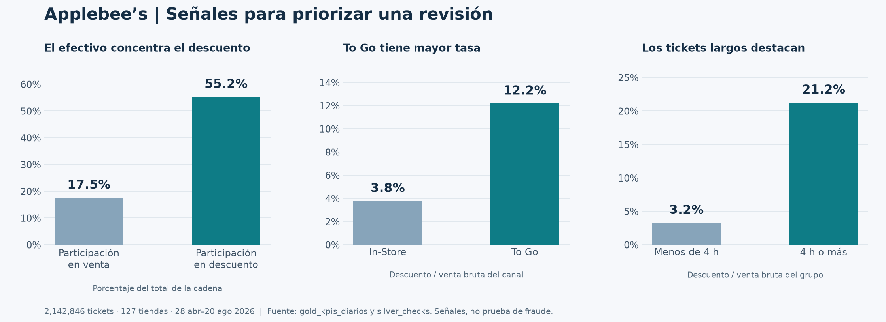

# Validación de la entrega · 29 de octubre de 2026

La versión revisada se desplegó y ejecutó con los 115 archivos reales en **`workspace.applebees_qa_a01706880`**, usando la fuente original de solo lectura. La instancia histórica `workspace.applebees` se conservó. Esta evidencia corresponde al código local que se prepara para commit; el commit base era `d0410d7`.

## Evidencia de ejecución

| Verificación | Resultado / evidencia |
|---|---|
| Pruebas locales de compuerta | 9 pruebas, incluyendo cada contador crítico, métricas faltantes/no finitas, ausencia de datos, límites y nombres de esquema |
| Bundle | `dev` y `qa`: `Validation OK!`; plan de QA: 0 altas, 0 cambios, 0 bajas, 3 recursos sin cambios |
| Código desplegado | Los 12 archivos de `src/` coinciden byte a byte con la exportación del workspace de QA |
| Carga completa | [Job 808698590368799](https://dbc-eb170ead-6845.cloud.databricks.com/jobs/863088189686369/runs/808698590368799): pipeline, compuerta y resumen de riesgo en `SUCCESS` |
| Actualización de carga | Pipeline `6eb8558c-b02d-44fe-a9fa-4ec17b154f9a`, update `a985ce6c-ca08-421c-aff6-047c2c853295` |
| Pruebas Spark y exploración | [Job 27803105942352](https://dbc-eb170ead-6845.cloud.databricks.com/jobs/733789107012968/runs/27803105942352): regresiones y los tres notebooks en `SUCCESS` |
| Precisión de tasas | [Job 249460964368166](https://dbc-eb170ead-6845.cloud.databricks.com/jobs/863088189686369/runs/249460964368166): las tres tareas en `SUCCESS` después de fijar la precisión de división |
| Idempotencia final | [Job 347077612023793](https://dbc-eb170ead-6845.cloud.databricks.com/jobs/863088189686369/runs/347077612023793): las tres tareas en `SUCCESS`; conteos y huellas de contenido idénticos en nueve tablas |
| Casos de parser | 15 casos reales en Spark: válido, campos extra raíz/anidados, ID/importe incompatible, nulos, fecha discordante, NaN, elemento inválido, archivo vacío, JSON roto, escalar y objeto en lugar de arreglo |
| Reglas de transformación | Importes decimales, suma item/ticket, conciliación, normalización de efectivo, duración de cuatro horas, autoaprobación y exclusión de identidades desconocidas |
| Consultas independientes | `validation/sql/`: completitud, unicidad, proporciones, negocio, identidades, catálogos y clustering |

El manifiesto [source_manifest.sha256](../validation/source_manifest.sha256) identifica los 26 archivos de código, configuración y pruebas revisados. Se puede verificar con `shasum -a 256 -c validation/source_manifest.sha256`.

Los archivos JSON brutos de la API y salidas de trabajo se agrupan en `.local/validation/`, ignorado por Git. Este documento conserva solamente resultados agregados y enlaces verificables. Los permisos del workspace siguen siendo necesarios para abrir las corridas.

## Volumen y controles

| Medida | Resultado |
|---|---:|
| Tickets bronze y silver | 2,142,846 en cada capa |
| Suma de tickets en KPIs gold | 2,142,846 |
| Archivos / días / tiendas activas | 115 / 115 / 127 |
| Rango de negocio | 28 abril–20 agosto de 2026 |
| Líneas de items | 28,558,925 |
| Movimientos de descuento | 516,690 |
| Movimientos de pago | 2,232,092 |
| Anulaciones | 178,303 |
| Filas de KPIs diarios | 130,259 |
| Diferencias de conteo entre capas | 0 en tickets, items, descuentos, pagos y voids |
| Llaves duplicadas | 0 |
| Registros rescatados | 0 |
| Tickets sin referencia a tienda/canal | 0 / 0 |
| Catálogos con IDs/atributos contradictorios | 0 |
| Identidades inválidas en el score | 0 |
| Tickets fuera de tolerancia de conciliación de $0.05 | 78 |
| Conciliación global | 99.99636% (2,142,768 / 2,142,846) |
| Peor conciliación diaria publicada | 99.974%; ningún día por debajo de 95% |
| Tasas inconsistentes con sus totales a nueve decimales | 0; comprobación crítica añadida al job |
| Porcentajes gold fuera de [0,1] | 0; antes se habían observado 84 por precisión binaria |

La compuerta exige cero en todos los contadores críticos y controla tanto el ratio global como el peor día. Las métricas de ratio publicadas por SQL están redondeadas por su tipo decimal; el porcentaje exacto anterior se calculó con el conteo independiente de 78 excepciones.

## Idempotencia y técnicas observadas

La última actualización `e1bf91b4-d432-48fa-8811-b54454affc3e` terminó en `COMPLETED`. La comparación usa `validation/sql/idempotencia.sql`: número de filas y suma decimal de `xxhash64(struct(*))`, una huella independiente del orden físico. Ambas medidas coinciden antes y después en bronze de tickets, las cinco tablas silver de hechos y las tres tablas gold de negocio. Es una comprobación agregada de regresión, no una prueba matemática libre de colisiones; la complementan conteos, importes y reglas de calidad. `gold_calidad_datos` se excluye de la huella porque su marca temporal cambia deliberadamente.

Los eventos de la reejecución anterior `b93e8534-e537-4dee-8ffe-3f5eaeca85ca` registraron agregación incremental para KPIs y dimensiones silver. El score, riesgo por tienda y calidad se recalcularon por completo: cross join en el score, elección del modelo de costo en tiendas y subconsultas/tiempo en calidad. Los catálogos bronze JSON también se recalcularon. Son técnicas observadas en esa corrida, no promesas para todas las actualizaciones futuras.

`DESCRIBE DETAIL silver_discounts` confirmó Delta con clustering en `dt`, `LocationId`, `EmployeeId`, sin particiones fijas. Las evidencias finales están en `.local/validation/release-evidence.json`; la comparación reproducible con `.local/validation/precision-before.json` terminó con `Idempotencia OK` en nueve tablas.

## Hallazgos de negocio verificados

| Indicador | Resultado y denominador |
|---|---|
| Venta bruta | $87,317,743.68 |
| Descuento total | $3,023,167.75; 3.4623% de la venta bruta |
| Efectivo | 17.5289% de la venta; 55.1834% del descuento |
| Tasa de descuento To Go / In-Store | 12.1783% / 3.7635%, aproximadamente 3.24 veces |
| Tasa en tickets abiertos ≥4h / resto | 21.2423% / 3.2483%, aproximadamente 6.54 veces |
| Tickets con bruto positivo y neto ≤$0.01 | 58,315; $1,111,005.71 de descuento asociado, 36.7497% del descuento total |
| Población evaluada | 2,959 pares empleado–tienda, todos con ID positivo en catálogo; en este dataset también son 2,959 IDs distintos |
| Nivel Alto / Medio / Bajo | 34 / 937 / 1,988 |
| Alto | 34 pares en 26 tiendas; $59,561.75 de descuentos asociados, sin afirmar que sean pérdidas |
| Descuentan ≥3× la mediana de su tienda | 41 pares evaluados |
| Autoaprobaciones en todos los descuentos positivos | 37 IDs y 37 pares empleado–tienda; 652 movimientos, $6,238.38 |
| Autoaprobaciones en la población elegible del score | 19 pares, subconjunto de los 37 anteriores |
| Regla de efectivo activada | 1,482 de 2,959 pares; señal frecuente que requiere calibración |



El efectivo mantiene una tasa de descuento aproximadamente 5.60 veces la de tarjeta incluso al excluir tickets con comidas de empleados. Los 34 casos Alto combinan varias señales: 34 tienen ≥50% del descuento en efectivo, 31 tienen al menos cinco tickets largos con descuento, 29 concentran ≥30% en MANAGER/WALKOUT y 19 tienen ≥10% sin gerente identificado.

La regla de ticket completamente descontado usa la tolerancia **neta ≤$0.01** de forma decimal. No se reutiliza el importe de una ejecución anterior con `double`, porque comparar un centavo binario puede cambiar esa clasificación. La comparación agregada autorizada contra el esquema histórico confirmó **45 tickets** cuya clasificación cambia: los 45 tienen neto decimal de $0.01; no se retiró ninguno de la señal. Incorporan $820.93 al importe asociado a esa clasificación. Ningún ticket cambió su venta bruta o descuento en más de $0.000001. Los totales de venta y descuento permanecen iguales. El nombre de la señal no sustituye la revisión de los ocho tickets cuyo descuento excede el bruto.

## Excepciones preservadas

| Observación | Resultado y política |
|---|---|
| Tickets sin items | 11,508; conservados, posibles cancelaciones/actividad sin venta |
| Líneas con bruto negativo | 6; conservadas y advertidas |
| Propinas con signo invertido | 3; conservar evita alterar el total en $17.48 |
| Descuento mayor al bruto en más de $0.05 | 8 tickets; revisión operativa |
| Diferencia `gross - sold - disc_item` mayor a $0.05 | 2 tickets; revisión contable |
| Movimientos de pago negativos | 3,779: 3,764 `GC SOLD`, 12 `CASH`, 3 `VISA`; semántica a confirmar con negocio |
| Descuentos con identidad desconocida | 2; preservados monetariamente, fuera del score, sin falsa autoaprobación |
| Empleados evaluados sin fecha de contratación | 63; antigüedad nula, no afecta las seis señales del score |

Estas observaciones no se borraron ni se convirtieron a cero para hacer pasar la compuerta. Su tratamiento está definido en [el contrato de calidad](calidad.md). Los umbrales iniciales permiten estas excepciones y se deben calibrar con negocio.

## Cierre de hallazgos de la auditoría anterior

| Hallazgo | Resolución |
|---|---|
| JSON inválido/campos nuevos no detectados | JSON por registro conservado, corrupción y esquema detectados recursivamente; suite Spark con entradas adversas |
| Identidad cero y autoaprobaciones falsas | IDs positivos para autoaprobación; catálogo obligatorio para score; cero excluido sin perder importes |
| Denominadores ambiguos | Separación explícita entre movimientos, IDs y pares elegibles |
| Despliegues de usuarios sobre mismas tablas | Catálogo/esquema parametrizados, destinos por usuario/target y guía de migración del compartido |
| Promesa excesiva de incrementalidad | Documentación distingue streaming incremental de técnicas elegidas por las materialized views |
| Falsas alertas numéricas | Importes decimales antes de sumar; cero incumplimientos en 130,259 KPIs |
| EDA dependiente de tablas históricas y textos pendientes | Tres notebooks de solo lectura, parámetros del bundle, todos ejecutados con éxito |
| Diagnóstico genérico con métricas vacías/nulas | Contrato puro, validación de cardinalidad/tipos/valores, pruebas unitarias y compuerta real exitosa |

## Regresión adicional detectada al reejecutar

La primera comparación de huellas identificó una diferencia que los totales no revelaban: el plan incremental de KPIs reducía la precisión de la división implícita y cambiaba 53,711 tasas, como máximo en 0.0000005. Los conteos y los importes monetarios se mantuvieron iguales. Se corrigió fijando los totales a DECIMAL(24,2) antes de dividir y el resultado a DECIMAL(18,9). El control `kpis_tasa_inconsistente` compara cada tasa contra los totales publicados y bloquea alertas si discrepan. La suite de aceptación también lo comprueba.

La prueba de límite monetario verifica `0.10 + 0.20 - 0.29 = 0.01` y la señal de ticket completamente descontado. Ambas correcciones evitan usar redondeos implícitos distintos según el plan de ejecución.

## Alcance y reproducción

La fecha máxima de negocio es agosto porque este es el dataset fijo de la competencia. `calculado_en` acredita el refresco, no la llegada de datos recientes. Una operación diaria real necesita acordar un SLA de frescura y reglas de negocio para las excepciones observadas.

Las pruebas muestran que esta versión funciona con el conjunto completo y con los casos sintéticos especificados. No representan una garantía para cualquier archivo futuro, ni un score calibrado con etiquetas de fraude. El acceso de evaluadores a GitHub, la entrega de su URL y la exposición oral no forman parte de una prueba de código.

```bash
python3 scripts/validate_local.py
databricks bundle run validation_job -t qa -p APPLEBEES
python3 scripts/collect_evidence.py --profile APPLEBEES \
  --warehouse-id ID_DEL_WAREHOUSE --schema ESQUEMA_DEL_TARGET
# Figura opcional a partir de esa evidencia:
uv run --with matplotlib python scripts/render_insights.py .local/validation/evidence.json
```
