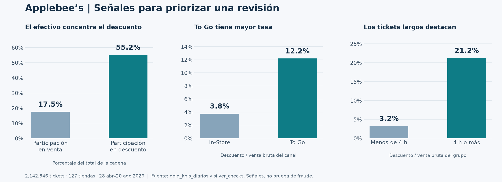

# Validación del pipeline

Corrimos el pipeline completo con los 115 archivos reales en un esquema de QA (`workspace.applebees_qa_<usuario>`), leyendo la fuente original sin modificarla. El esquema `workspace.applebees` de la primera versión no se tocó.

## Corridas

| Prueba | Resultado |
|---|---|
| Pruebas locales de la compuerta | 9 pruebas: cada contador crítico, métricas faltantes o no finitas, sin datos y límites |
| Bundle | `databricks bundle validate` correcto en `dev` y `qa` |
| Carga completa (115 días) | Pipeline, compuerta y alertas en `SUCCESS` |
| Job de validación | Pruebas con Spark y los tres notebooks de exploración en `SUCCESS` |
| Segunda corrida sin archivos nuevos | Mismos conteos y mismas huellas de contenido en nueve tablas |
| Casos de error en el parser | 15 casos: ticket válido, campos extra (raíz y anidados), tipos incompatibles, nulos, fecha distinta a la carpeta, NaN, archivo vacío, JSON roto, escalar y objeto en lugar de arreglo |
| Reglas de transformación | Importes decimales, suma item + ticket, conciliación, efectivo, 4 horas, autoaprobación y empleados desconocidos |
| Consultas independientes | `validation/sql/`: completitud, unicidad, proporciones, negocio, catálogos y clustering |

`validation/source_manifest.sha256` lista los archivos de código revisados: `shasum -a 256 -c validation/source_manifest.sha256`.

## Volumen y controles

| Medida | Resultado |
|---|---:|
| Tickets bronze y silver | 2,142,846 en cada capa |
| Suma de tickets en KPIs gold | 2,142,846 |
| Archivos / días / tiendas activas | 115 / 115 / 127 |
| Rango de negocio | 28 abr – 20 ago 2026 |
| Líneas de items | 28,558,925 |
| Movimientos de descuento | 516,690 |
| Movimientos de pago | 2,232,092 |
| Anulaciones | 178,303 |
| Filas de KPIs diarios | 130,259 |
| Diferencias de conteo entre capas | 0 en tickets, items, descuentos, pagos y voids |
| Llaves duplicadas | 0 |
| Registros rescatados | 0 |
| Tickets sin tienda / sin canal | 0 / 0 |
| Catálogos con atributos contradictorios | 0 |
| Tickets fuera de la tolerancia de $0.05 | 78 |
| Conciliación global | 99.996 % (2,142,768 / 2,142,846) |
| Peor día | 99.974 % |
| Porcentajes gold fuera de [0, 1] | 0 |

## Idempotencia y clustering

Para comprobar que una corrida sin archivos nuevos no cambia nada, `validation/sql/idempotencia.sql` calcula filas y una huella `xxhash64(struct(*))` por tabla antes y después. Coincidieron en bronze, las cinco tablas silver de hechos y las tres gold de negocio. `gold_calidad_datos` se excluye porque su columna `calculado_en` cambia en cada corrida.

En los eventos del pipeline se ve que los KPIs y las dimensiones silver se actualizaron de forma incremental, mientras que el score de riesgo, el riesgo por tienda y calidad se recalcularon completos (usan medianas y comparaciones globales). `DESCRIBE DETAIL silver_discounts` confirma liquid clustering en `dt`, `LocationId` y `EmployeeId`.

## Hallazgos de negocio

| Indicador | Resultado |
|---|---|
| Venta bruta | $87,317,743.68 |
| Descuento total | $3,023,167.75 (3.46 % de la venta) |
| Efectivo | 17.5 % de la venta y 55.2 % del descuento |
| Tasa de descuento To Go / In-Store | 12.2 % / 3.8 % (3.2×) |
| Tasa en tickets abiertos 4 h+ / resto | 21.2 % / 3.2 % (6.5×) |
| Tickets descontados al 100 % | 58,315 tickets; $1,111,005.71 (36.7 % del descuento) |
| Empleados evaluados | 2,959 pares empleado–tienda |
| Nivel Alto / Medio / Bajo | 34 / 937 / 1,988 |
| Riesgo Alto | 34 empleados en 26 tiendas; $59,561.75 en descuentos |
| Descuentan ≥ 3× la mediana de su tienda | 41 |
| Autoaprobaciones | 37 empleados, 652 movimientos, $6,238.38 (19 de ellos dentro de la población del score) |
| Regla de efectivo activada | 1,482 de 2,959; es la señal que más hay que calibrar |



Aun quitando las comidas de empleados, el efectivo descuenta 5.6× más que la tarjeta. Los 34 casos Alto combinan varias señales: los 34 tienen ≥ 50 % de su descuento en efectivo, 31 tienen al menos cinco tickets largos con descuento, 29 concentran ≥ 30 % en MANAGER/WALKOUT y 19 tienen ≥ 10 % sin gerente.

## Excepciones que se conservan

| Caso | Cantidad y tratamiento |
|---|---|
| Tickets sin items | 11,508; posibles cancelaciones |
| Líneas con bruto negativo | 6; se advierten |
| Propinas con signo invertido | 3 ($17.48) |
| Descuento mayor al bruto (más de $0.05) | 8 tickets; para revisión |
| `gross − sold − disc_item` mayor a $0.05 | 2 tickets |
| Pagos negativos | 3,779 (3,764 `GC SOLD`, 12 `CASH`, 3 `VISA`); por confirmar con negocio |
| Descuentos con empleado desconocido | 2; se conservan los montos pero quedan fuera del score |
| Empleados sin fecha de contratación | 63; antigüedad nula, no afecta el score |

No se borran ni se ponen en cero para pasar la compuerta; su tratamiento está en [calidad](calidad.md).

## Cambios respecto a la primera versión (28 oct)

| Problema | Corrección |
|---|---|
| JSON inválido o campos nuevos no se detectaban | Se guarda el JSON de cada ticket y se detectan campos extra en todos los niveles |
| Empleado con ID 0 contaba como autoaprobación | Autoaprobación solo con IDs positivos; el score solo incluye empleados del catálogo |
| Varias personas desplegando sobre las mismas tablas | Catálogo y esquema parametrizados por target y usuario |
| Errores de redondeo en porcentajes | Importes en DECIMAL antes de sumar; las tasas se calculan con DECIMAL(24,2) → DECIMAL(18,9) |
| Notebooks del EDA dependían de tablas viejas | Los tres notebooks leen del esquema del bundle y corren en el job de QA |
| Compuerta con mensajes genéricos | Reglas en `quality_rules.py` con pruebas unitarias |

Al repetir la corrida, la comparación de huellas encontró 53,711 tasas de KPIs que cambiaban en la séptima cifra decimal según el plan de ejecución. Por eso se fijó la precisión de la división y se agregó el control `kpis_tasa_inconsistente` a la compuerta.

## Alcance

El dataset termina el 20 de agosto, así que `calculado_en` indica cuándo se refrescó la tabla, no que lleguen datos nuevos. Para operación diaria real faltaría acordar con negocio un límite de frescura. El score todavía no está calibrado con casos de fraude confirmados.

## Cómo reproducirlo

```bash
python3 scripts/validate_local.py
databricks bundle run validation_job -t qa
python3 scripts/collect_evidence.py --warehouse-id ID_DEL_WAREHOUSE --schema ESQUEMA_DEL_TARGET
```
